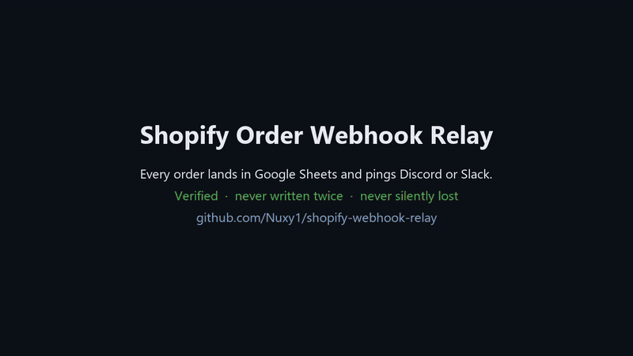
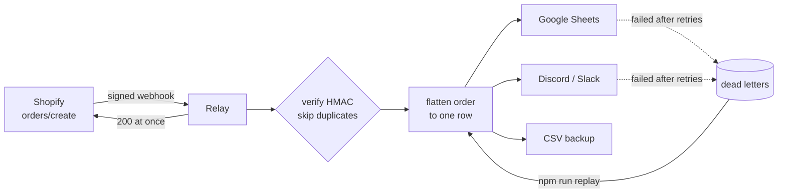

# Shopify Order Webhook Relay

Every new Shopify order lands as a clean row in a Google Sheet and pings your team on Discord or Slack. It happens within seconds, never twice, and is never silently lost.





## What it does

- **Verifies every webhook.** Shopify's HMAC-SHA256 signature is checked against the raw body. Forged or tampered requests get a `401` and never touch your data.
- **Answers Shopify at once.** Shopify waits only 5 seconds and retries on a timeout, so the relay acknowledges first and delivers after.
- **Never writes the same order twice.** Shopify delivers at least once, so repeated deliveries are recognised by their webhook id and skipped.
- **Retries what fails.** Google or Discord down, or a rate limit (`429`)? Each destination is retried on its own, with exponential backoff and jitter, honouring `Retry-After`. A request that can never succeed (`400`) is not retried.
- **Loses nothing.** A delivery that still fails is written to a dead-letter file. Fix the cause (a revoked key, a renamed tab), then run `npm run replay`. Only the destinations that failed are sent again.
- **Cleans the data.** Phone numbers go to E.164, emails are trimmed and lower-cased, times go to UTC ISO 8601, and line items become one readable cell (`2 x Ceramic Mug (Ash Grey); 1 x Pour-Over Kit`).
- **Has no dependencies.** It needs only Node.js 22+. Google's service-account login is done with Node's own crypto, so there's no `googleapis` package to keep updated.

## The row it writes

| order | created_at | customer | email | phone | items | item_count | total | currency | city | country | payment |
|---|---|---|---|---|---|---|---|---|---|---|---|
| #1042 | 2026-10-27T14:15:00.000Z | Jordan Example | jordan.example@example.com | +15550104477 | 2 x Ceramic Mug (Ash Grey); 1 x Pour-Over Kit | 3 | 84.50 | USD | Columbus | US | paid |

## Try it in one minute (no accounts needed)

```bash
npm test              # 10 tests: signatures, duplicates, retries, dead letters, the HTTP server, the Sheets login
npm start             # terminal 1: listens on :3000 with the CSV backup only
npm run demo          # terminal 2: sends the sample order, signed as Shopify signs it
cat data/orders.csv   # the row
```

## Set it up for a store

1. **Configure the relay.** Copy `.env.example` to `.env`.
2. **Google Sheets** (optional):
   - In Google Cloud, create a service account and download its JSON key.
   - Share the spreadsheet with the key's `client_email` as an Editor.
   - Set `SHEET_ID` (from the sheet's URL), `SHEET_RANGE` (for example `Orders!A1`) and `GOOGLE_SERVICE_ACCOUNT` (the key file's path, or its JSON).
3. **Discord or Slack** (optional): create an incoming webhook and put its URL in `NOTIFY_WEBHOOK_URL`.
4. **Deploy** to any Node host with HTTPS (Render, Railway, Fly.io, a VPS behind Caddy). Shopify only calls HTTPS URLs.
5. **Connect Shopify:**
   - In the Shopify admin, go to Settings > Notifications > Webhooks and create an `Order creation` webhook in JSON. Point it at `https://<your-host>/webhooks/shopify/orders`.
   - Copy the signing secret shown there into `SHOPIFY_WEBHOOK_SECRET`.
6. **Check it:** `GET /health` answers `ok`. Then place a test order.

## Project layout

```
src/verify.js       HMAC check (timing-safe)
src/transform.js    order -> row, phone normalisation
src/relay.js        verify, dedupe, acknowledge, deliver, dead-letter, replay
src/retry.js        backoff with jitter; which HTTP errors are worth retrying
src/sinks/          sheets.js (service-account JWT + append), notify.js (Discord/Slack), csv.js
src/server.js       node:http server, 1 MB body limit, graceful shutdown that finishes acknowledged deliveries
scripts/            send-test-webhook.js, replay-dead-letters.js
```

## Notes for production

- Duplicate detection is kept in memory, which is right for one instance. Behind a load balancer with several instances, move it to Redis or a database table.
- The CSV backup and the dead letters hold customer details. Keep `data/` on private storage, and rotate or delete it as the store's privacy policy requires.
- To add another destination (Airtable, HubSpot, an email), add one file in `src/sinks/` that exposes `write(values, row)`.
